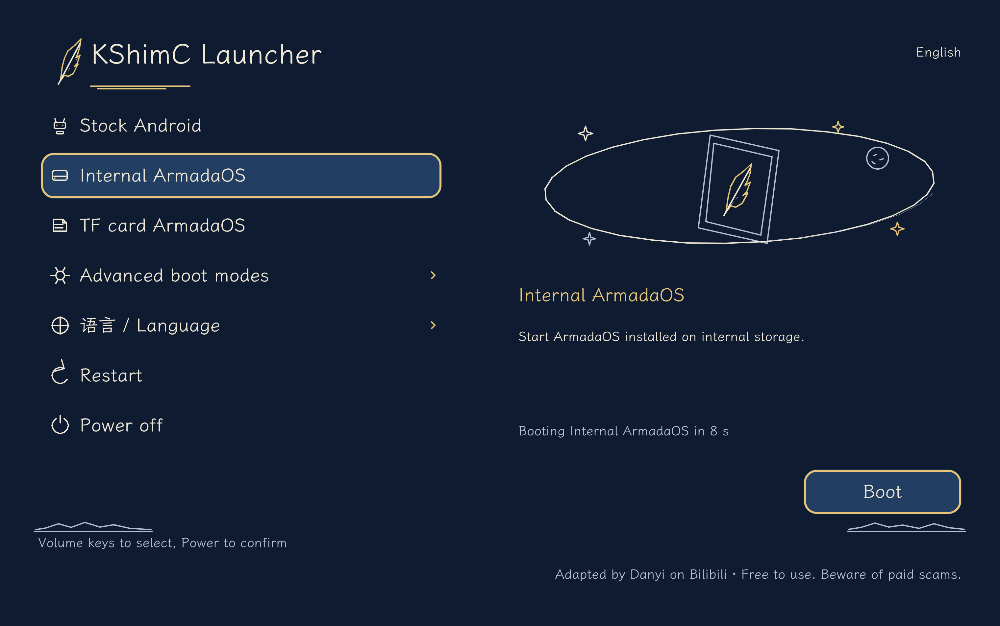

<p align="center">
  <picture>
    <source media="(prefers-color-scheme: dark)" srcset=".github/assets/armada-mark-white.svg">
    
  </picture>
</p>

<h1 align="center">ArmadaOS Freedom</h1>

<p align="center"><strong>SteamOS-like Linux for ARM tablets</strong></p>

<p align="center">
  A tablet-focused fork of <a href="https://github.com/armada-os/armada">ArmadaOS</a>,
  bringing Steam Gaming Mode, FEX, Proton, and KDE Plasma to ARM64 tablets,
  with kShimC multi-boot.
</p>

<p align="center">
  <a href="https://github.com/armada-os/armada"></a>
  <a href="devices/lenovo-tb323fu/README.md"></a>
  <a href="LICENSE.md"></a>
</p>

<p align="center">
  <a href="devices/lenovo-tb323fu/README.md"><strong>Device support &amp; status</strong></a>
  ·
  <a href="#kshimc-multi-boot">Boot menu</a>
  ·
  <a href="devices/lenovo-tb323fu/docs/SOURCES.md">Sources</a>
  ·
  <a href="https://armadaos.dev/">Upstream documentation</a>
</p>

## About ArmadaOS Freedom

ArmadaOS Freedom is a community-maintained tablet branch based on
[ArmadaOS](https://github.com/armada-os/armada). It retains the upstream gaming
and desktop foundation while adapting boot, display, power, peripherals, and
Armada Control to tablet hardware. Current device work focuses on the
**Lenovo Legion Tab Gen 5 / Y700 (TB323FU, SM8850P)**.

本项目是基于 ArmadaOS、面向 ARM 平板的适配分支，当前主要维护 Y700 五代。
使用 kShimC 启动器选择 Android、机身 ArmadaOS 或 TF 卡 ArmadaOS。
设备适配状态和已知问题见[设备维护入口](devices/lenovo-tb323fu/README.md)。

Highlights of the current adaptation:

- Steam Gaming Mode and KDE Plasma, with FEX and Proton from ArmadaOS.
- kShimC multi-boot with separate internal-storage and TF-card Linux entries.
- Device-matched 30 / 60 / 90 / 120 / 165 Hz display modes.
- Dual-USB routing, audio, 5 GHz Wi-Fi, battery and temperature reporting.
- G9 2026 controller mapping, RGB control, and double-Home quick access.
- Tablet-aware Armada Control, including hiding fan controls on fanless devices.

This is an adaptation source tree, not yet a complete, reproducibly built and
fully validated tablet image release. Kernel/boot integration with the upstream
image build and OTA update path is still in progress. Current limitations,
including display and game stability issues, are tracked in the
[device documentation](devices/lenovo-tb323fu/README.md#已知限制).

## kShimC multi-boot

The tablet boot path uses **kShimC**, packaged with the boot payloads in the
Android boot image. It keeps the factory boot chain and presents a menu for:

- Android.
- ArmadaOS installed in internal storage.
- ArmadaOS installed on a TF / microSD card.
- Advanced boot: Linux diagnostics, Recovery, Fastboot, and 9008 / EDL.
- Language selection, restart, and shutdown.

This fork no longer ships the custom ROCKNIX ABL firmware, flashing scripts, or
automatic ABL updater. The factory bootloader remains part of the device boot
chain; kShimC provides the system-selection menu.

The Linux kernel and device tree are boot payloads; Linux then mounts the root
filesystem selected by the internal-storage or TF-card entry. These are two
separate installation targets. The menu does not imply direct SD/UFS filesystem
support in kShimC.

<p align="center">
  
</p>

*STAR_CHART menu rendered from the current implementation; this is a software
preview, not a photograph of the tablet.*

<details>
<summary>English menu preview</summary>



</details>

Menu sources and build inputs are under
[`devices/lenovo-tb323fu/boot/`](devices/lenovo-tb323fu/boot/).
See the [build recipe](devices/lenovo-tb323fu/boot/star-chart-build/README.md)
for pinned dependencies and device-specific payload requirements. Advanced boot
actions have not all been individually validated on hardware.

## Documentation

| I want to… | Guide |
|---|---|
| Check tablet support and known issues | [TB323FU device documentation](devices/lenovo-tb323fu/README.md) |
| Inspect the boot build | [kShimC build recipe](devices/lenovo-tb323fu/boot/star-chart-build/README.md) |
| Check component origins and versions | [Sources and provenance](devices/lenovo-tb323fu/docs/SOURCES.md) |
| Learn the upstream system | [Using ArmadaOS](https://armadaos.dev/using-armada/) |
| Report a tablet-branch issue | [Freedom issues](https://github.com/mydanyi/armadaos-freedom/issues) |

Upstream installation instructions describe upstream-supported devices. Use the
model-specific documentation here for the tablet boot path; do not treat a
generic upstream image or bootloader package as a TB323FU installation package.

## Development

The repository retains the upstream bootc image and package build foundation,
plus tablet sources and overlays under [`devices/`](devices/). These overlays
are not all integrated into the generic image recipes yet. Package development
is documented in [`packages/`](packages/README.md); upstream recipes use
[just](https://just.systems/) and [Podman](https://podman.io/):

```console
$ just check     # Run the test suite and check recipe formatting
$ just packages  # Build the packages the image consumes
$ just build     # Build the bootc container; not a ready-to-flash tablet image
$ just --list    # List development recipes
```

For device work, follow the relevant overlay/build instructions and preserve
model-based matching. Reports, device logs, credentials, backups, and local
build outputs are kept outside the repository.

## Credits

Based on [ArmadaOS](https://github.com/armada-os/armada), whose foundation uses
[Fedora bootc](https://github.com/bootc-dev/bootc) and device support derived from
[ROCKNIX](https://github.com/ROCKNIX). See the
[upstream credits](https://armadaos.dev/project/credits/) and our
[component sources](devices/lenovo-tb323fu/docs/SOURCES.md) for contributors,
boot projects, kernel sources, and pinned versions. The Armada logo was created
by [Rax](https://github.com/Raxcoms).

## License

Armada's own code is licensed under **GPL-2.0-or-later**. Bundled components
retain their upstream licenses. See [LICENSE.md](LICENSE.md).
